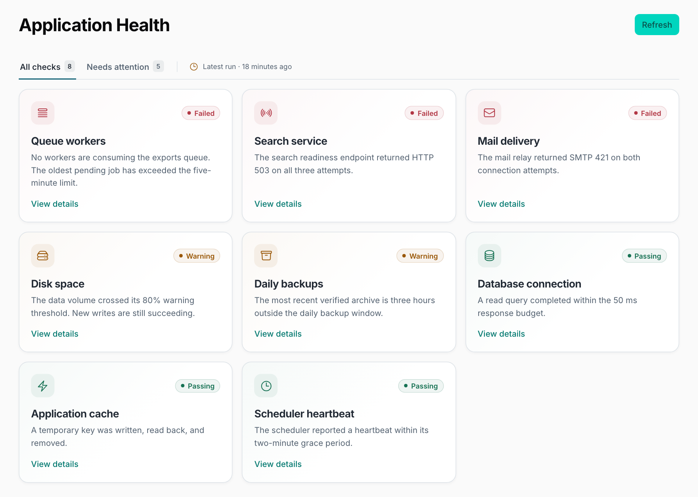

# Filament Spatie Laravel Health

[](https://packagist.org/packages/shuvroroy/filament-spatie-laravel-health)
[](https://github.com/shuvroroy/filament-spatie-laravel-health/actions?query=workflow%3Arun-tests+branch%3Amain)
[](https://packagist.org/packages/shuvroroy/filament-spatie-laravel-health)
[](https://packagist.org/packages/shuvroroy/filament-spatie-laravel-health)
[](https://packagist.org/packages/shuvroroy/filament-spatie-laravel-health)

This package adds a Filament page for monitoring checks registered with [spatie/laravel-health](https://spatie.be/docs/laravel-health/v1/introduction). It supports Filament 4 and 5 and PHP 8.2 or newer. CI tests PHP 8.6 with Laravel 13.

<picture>
  <source media="(prefers-color-scheme: dark)" srcset="art/results-dark.png">
  
</picture>

View the results page in [light mode](art/results-light.png) or [dark mode](art/results-dark.png).

## Installation

Install the package via Composer:

```bash
composer require shuvroroy/filament-spatie-laravel-health
```

Laravel Health can store results [in various ways](https://spatie.be/docs/laravel-health/v1/storing-results/general). If you use its default Eloquent result store, publish and run the migration that creates the `health_check_result_history_items` table:

```bash
php artisan vendor:publish --tag="health-migrations"
php artisan migrate
```

## Usage

Register the plugin in your Filament panel provider, such as `AdminPanelProvider`:

```php
<?php

namespace App\Providers\Filament;

use Filament\Panel;
use Filament\PanelProvider;
use ShuvroRoy\FilamentSpatieLaravelHealth\FilamentSpatieLaravelHealthPlugin;

class AdminPanelProvider extends PanelProvider
{
    public function panel(Panel $panel): Panel
    {
        return $panel
            // ...
            ->plugin(FilamentSpatieLaravelHealthPlugin::make());
    }
}
```

After registering the plugin, publish the panel assets:

```bash
php artisan filament:assets
```

Register your health checks in the `boot()` method of `app/Providers/AppServiceProvider.php`:

```php
<?php

namespace App\Providers;

use Illuminate\Support\ServiceProvider;
use Spatie\Health\Facades\Health;
use Spatie\Health\Checks\Checks\DebugModeCheck;
use Spatie\Health\Checks\Checks\EnvironmentCheck;
use Spatie\Health\Checks\Checks\OptimizedAppCheck;

class AppServiceProvider extends ServiceProvider
{
    public function boot(): void
    {
        Health::checks([
            OptimizedAppCheck::new(),
            DebugModeCheck::new(),
            EnvironmentCheck::new(),
        ]);
    }
}
```

See the [available checks](https://spatie.be/docs/laravel-health/v1/available-checks/overview) in the Laravel Health documentation.

## Viewing results

Open **Application Health** in the panel to see the latest stored results. Select **Needs attention** to show warnings, failures, and crashed checks. Skipped checks also appear when Spatie's `health.treat_skipped_as_failure` setting is enabled (the default). The filtered URL can be bookmarked or shared with another authorized user.

To populate the page for the first time, select **Refresh** or run `php artisan health:check`. Opening the page and switching filters read the stored results. **Refresh** runs the checks again.

## Optional dashboard widget

Enable the widget in the panel provider for each dashboard where you want it:

```php
$panel->plugin(FilamentSpatieLaravelHealthPlugin::make()->dashboardWidget());
```

<picture>
  <source media="(prefers-color-scheme: dark)" srcset="art/widget-dark.png">
  
</picture>

View the widget in [light mode](art/widget-light.png) or [dark mode](art/widget-dark.png).

The widget reads saved results every minute while visible. It shows the last run time and previews up to two checks per affected status, starting with crashed and failed checks.

Select **All checks** in the widget header to open the full list. When checks need attention, select **Needs attention** beside the chart to open the filtered results.

With Spatie's Eloquent store active and at least two recorded runs, the chart shows how many checks needed attention in each of the most recent runs (up to 12, oldest first). Hover, tap, or focus a bar for the run time and affected count out of the total. With one run or a latest-only store, the widget shows a status breakdown of the latest results.

The widget respects the plugin's authorization callback and the configured results page's access rules.

## Customising the navigation

The plugin exposes methods for changing the page's navigation group, sort order, icon, and label. Each option also accepts a closure when the value needs to be determined at runtime.

```php
FilamentSpatieLaravelHealthPlugin::make()
    ->navigationGroup('System')
    ->navigationSort(10)
    ->navigationIcon('heroicon-o-cpu-chip')
    ->navigationLabel('Application Health');
```

Pass `null` to `navigationGroup()` to remove the default navigation group. Pass `null` to `navigationLabel()` to use the translated default label.

## Using a custom page

Extend the default page when you need to customise page-specific behavior, such as its heading or view. Configure navigation through the plugin methods described above.

```php
<?php

namespace App\Filament\Pages;

use Illuminate\Contracts\Support\Htmlable;
use ShuvroRoy\FilamentSpatieLaravelHealth\Pages\HealthCheckResults as BaseHealthCheckResults;

class HealthCheckResults extends BaseHealthCheckResults
{
    public function getHeading(): string | Htmlable
    {
        return 'Health Check Results';
    }
}
```

Then pass the custom page class to the plugin in your panel provider:

```php
<?php

namespace App\Providers\Filament;

use App\Filament\Pages\HealthCheckResults;
use Filament\Panel;
use Filament\PanelProvider;
use ShuvroRoy\FilamentSpatieLaravelHealth\FilamentSpatieLaravelHealthPlugin;

class AdminPanelProvider extends PanelProvider
{
    public function panel(Panel $panel): Panel
    {
        return $panel
            // ...
            ->plugin(
                FilamentSpatieLaravelHealthPlugin::make()
                    ->usingPage(HealthCheckResults::class),
            );
    }
}
```

## Authorising access

The page is accessible by default. Pass a boolean or closure to `authorize()` to restrict access:

```php
<?php

namespace App\Providers\Filament;

use Filament\Panel;
use Filament\PanelProvider;
use ShuvroRoy\FilamentSpatieLaravelHealth\FilamentSpatieLaravelHealthPlugin;

class AdminPanelProvider extends PanelProvider
{
    public function panel(Panel $panel): Panel
    {
        return $panel
            // ...
            ->plugin(
                FilamentSpatieLaravelHealthPlugin::make()
                    ->authorize(fn (): bool => auth()->user()?->email === 'admin@example.com'),
            );
    }
}
```

## Upgrading

Please see [UPGRADE](UPGRADE.md) for details on how to upgrade 1.X to 2.0.

## Testing

```bash
composer test
composer test:coverage
composer analyse
composer format
```

The coverage command requires Xdebug or PCOV and fails when coverage is below 100%.

## Changelog

Please see [CHANGELOG](CHANGELOG.md) for more information on what has changed recently.

## Contributing

Please see [CONTRIBUTING](.github/CONTRIBUTING.md) for details.

## Security Vulnerabilities

Please review [our security policy](../../security/policy) on how to report security vulnerabilities.

## Credits

- [Shuvro Roy](https://github.com/shuvroroy)
- [All Contributors](../../contributors)

## License

The MIT License (MIT). Please see [License File](LICENSE.md) for more information.
